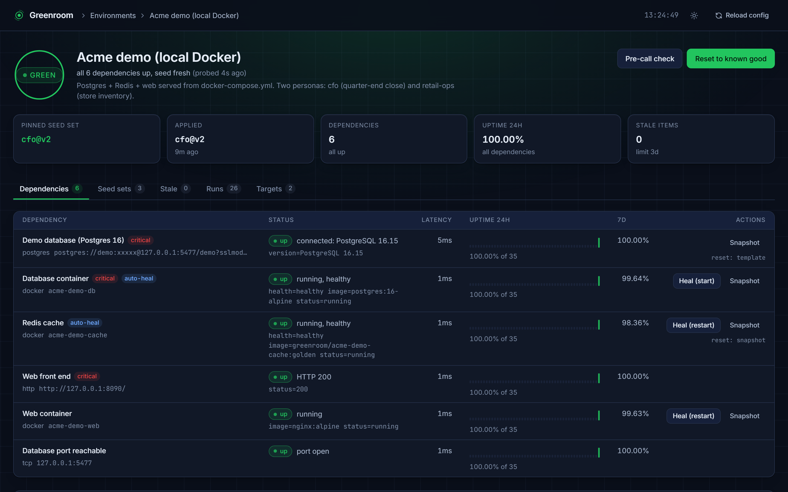
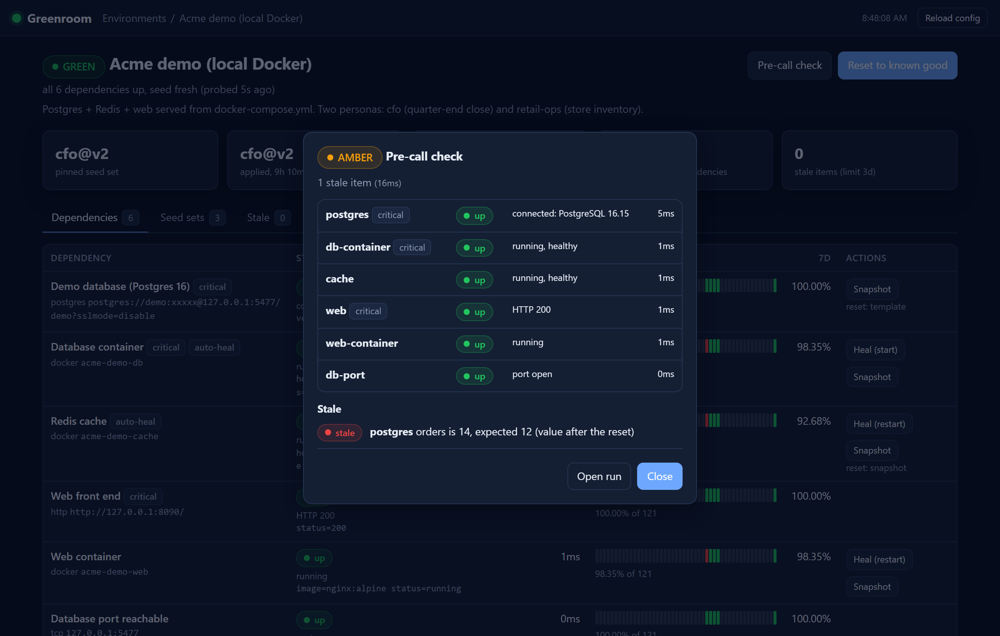
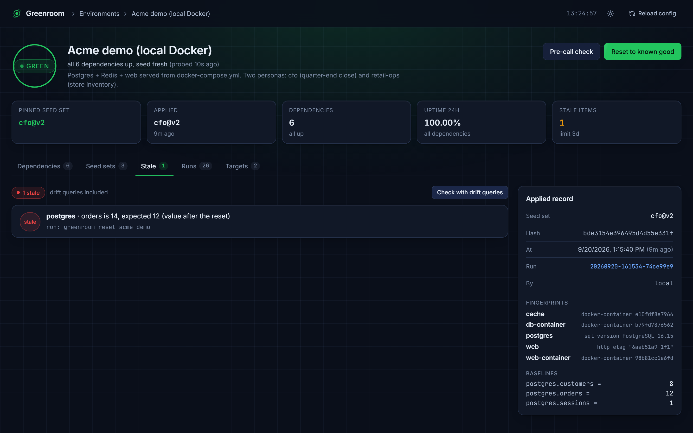
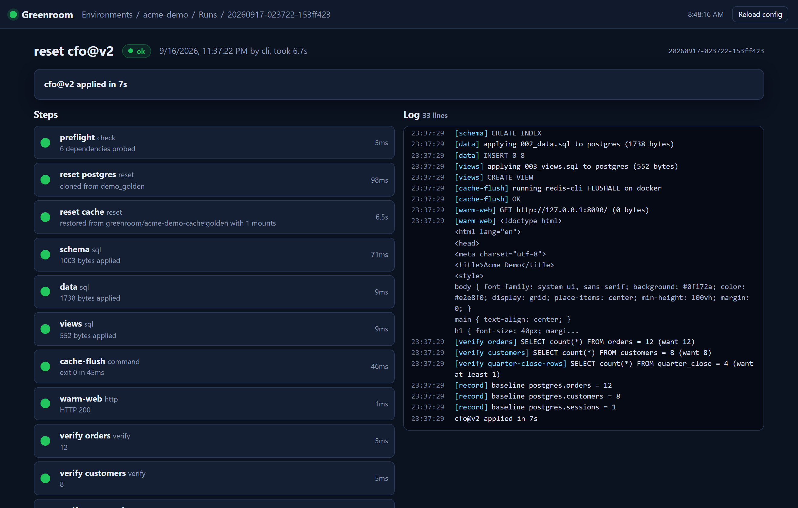

<p align="center">
  
</p>

<h1 align="center">Greenroom</h1>

<p align="center">
  <b>Every demo starts from a known-good state.</b><br>
  Versioned seed sets, one-command resets, pre-call health checks and a stale report,<br>
  for demo environments on Docker, Kubernetes, EKS and EC2.
</p>

<p align="center">
  <a href="https://github.com/dboudreau00/greenroom/actions/workflows/ci.yml"></a>
  <a href="https://github.com/dboudreau00/greenroom/releases"></a>
  
  <a href="LICENSE"></a>
</p>

<p align="center">
  
</p>

## The problem

A demo environment is a shared stage. Between calls, someone runs a
walkthrough and leaves orders behind. A container gets recreated and the
data goes with it. The SQL bastion gets stopped overnight to save money.
The seed script in the repo moves on to version 3 while the environment is
still running version 2. A certificate quietly expires. You find out on the
call, in front of the prospect.

Greenroom makes the state of a demo environment a versioned, checkable,
resettable thing.

## What it does

**Seed sets are code.** `environments/<env>/seeds/<persona>/v<N>/` holds a
manifest and its files: SQL, fixtures, scripts, HTTP calls. Personas are
whatever your motion needs (`cfo`, `retail-ops`, `healthcare`). Every file
is content hashed and the hash is recorded when the set is applied, so an
edit after the fact shows up as stale.

**One command resets to known good.** `greenroom reset <env>` probes and
heals, runs each dependency's reset strategy (Postgres template clone,
schema drop, Docker snapshot restore or recreate, Kubernetes rollout
restart, EC2 reboot, or your own script), applies the seed steps, verifies,
and records fingerprints. `greenroom snapshot` makes the restore fast by
cloning a Postgres database into a template, or committing a container with
its volumes archived.

**Pre-call check in seconds.** `greenroom check <env>` probes every
dependency in parallel: TCP ports, TLS expiry, HTTP endpoints, Postgres and
MySQL, Docker containers and their healthchecks, Kubernetes workloads, EC2
instances and their status checks, arbitrary commands. GREEN, AMBER or RED,
with exit codes to match, so it slots into a calendar hook or CI.

**It tells you what is stale, and why.** Never reset. Pinned v3 but v2
applied. Seed files changed since the reset (with the file list). Reset
older than the limit. Container or instance replaced underneath. A drift
check like `SELECT count(*) FROM orders` that no longer matches what the
reset left behind.

**Uptime and self-healing.** The portal's scheduler runs the same probes on
an interval. Every dependency gets 24 hour and 7 day uptime, an incident
list, and, when marked `autoHeal`, gets started, restarted or scaled back
without anyone watching.

## Start from a template

Pick the product type and the modules the call is going to show; Greenroom
writes the environment, a seed set per persona, the drift checks and the
verify queries for exactly those modules.

```bash
greenroom templates
greenroom new acme-crm --template saas-web --modules billing,support --persona cfo
docker compose -f environments/acme-crm/docker-compose.yml up -d
greenroom reset acme-crm
```

| Template | Product | Modules |
| --- | --- | --- |
| `saas-web` | SaaS web app on Docker Compose | accounts, billing, analytics, support, inventory |
| `warehouse-bastion` | Analytics warehouse behind an EC2 bastion | sales, marketing and finance marts |
| `k8s-microservices` | Commerce platform on Kubernetes or EKS | catalog, orders, payments, search |

Add your own under `templates/`; see [docs/TEMPLATES.md](docs/TEMPLATES.md).

## Personalize for the prospect

Fetch a brand kit from the prospect's website and reset the demo in their
name, colors and logo. Seed steps that set `personalize` get
`{{brand.name}}`, `{{brand.primary}}` and the rest, escaped for SQL, JSON,
HTML, CSS or a URL by where they land; an `asset` step drops the logo into
the app. Without a kit, the environment's house brand fills the same slots.

```bash
greenroom brand fetch https://larkspur.example
greenroom reset acme-crm --brand larkspur
```

The link fetcher only reaches public addresses on ports 80 and 443, checks
every address it dials, and refuses SVG that could run script. An edited
or deleted kit shows up in the stale report. See
[docs/PERSONALIZE.md](docs/PERSONALIZE.md).

## Book the demo, not just the environment

A booked demo ties a prospect, an environment, a seed set and a brand kit
to a time slot. Before the call the portal resets the environment for the
prospect and runs the pre-call check; while the demo is live it refuses
other resets unless someone overrides; afterwards it can reset back to the
pin. Every demo keeps a journal, and the tracker and an `.ics` feed show
what is coming.

```bash
greenroom book acme-crm --at "2026-11-20 15:00" --for 45m --title "Larkspur discovery" \
  --prospect Larkspur --persona cfo@v2 --brand larkspur --reset-after
greenroom demos
greenroom demo note 20261120-1500-3f9a --kind issue "Export took 40s on the orders page"
```

See [docs/DEMOS.md](docs/DEMOS.md).

## Five minutes to green

```bash
greenroom init                                   # scaffold a workspace with the bundled example
docker compose -f environments/acme-demo/docker-compose.yml up -d
greenroom check acme-demo                        # GREEN / AMBER / RED, exit 0 / 1 / 2
greenroom snapshot acme-demo postgres            # capture the known-good template
greenroom reset acme-demo                        # restore it and apply the pinned seed set
greenroom stale acme-demo                        # what drifted since
greenroom serve                                  # portal on http://127.0.0.1:8470
```

```
$ greenroom check acme-demo
GREEN  acme-demo  all 6 dependencies up, seed fresh (13ms)
  up  postgres       5ms  connected: PostgreSQL 16.15 (critical)
  up  db-container   1ms  running, healthy (critical)
  up  cache          1ms  running, healthy
  up  web            1ms  HTTP 200 (critical)
  up  web-container  1ms  running
  up  db-port        0s   port open
  seed fresh: cfo@v2

$ greenroom stale acme-demo
acme-demo: pinned cfo@v2, applied cfo@v2 at 2026-09-16 23:37
  [stale] postgres: orders is 14, expected 12 (value after the reset)
          fix: run: greenroom reset acme-demo
```

Binaries for Linux, macOS and Windows are on the
[releases page](https://github.com/dboudreau00/greenroom/releases), and a
container image at `ghcr.io/dboudreau00/greenroom`.

## Attach it to what you run

| Platform | Target kind | Probes | Reset and heal | Seed steps run |
| --- | --- | --- | --- | --- |
| Docker | `docker` (socket, npipe, tcp, tls) | container running and healthy | restart, recreate, snapshot restore; start, restart | docker exec |
| Kubernetes, EKS | `kubernetes` (kubeconfig with exec plugins, in-cluster, explicit token) | deployment, statefulset, daemonset, pod ready | rollout restart; scale | pod exec over WebSocket |
| EC2 | `aws` (env, profile with assume role, IRSA, task role, instance profile) | instance running and status checks | reboot; start | SSM Run Command |
| SSH host | `ssh` | command probes | command | ssh with stdin |
| Postgres, MySQL | direct DSN, or `via` any target above | connect and version | template, schema, script | driver, or psql / mysql on the far side |
| Anything with a port or URL | none needed | tcp, tls, http | command | local |

The Docker, Kubernetes, AWS and WebSocket clients are written in the repo
against the raw APIs. The binary has two dependencies, the Postgres and
MySQL drivers, builds without cgo, and cross-compiles everywhere Go does.

## The SQL bastion case

A warehouse behind a bastion that must stay up, seeded and checked without
the database ever being reachable from where Greenroom runs:

```json
{
  "name": "warehouse-demo",
  "pin": { "persona": "analyst", "version": 3 },
  "staleAfter": "72h",
  "targets": { "aws": { "kind": "aws", "region": "us-east-1" } },
  "dependencies": [
    { "name": "sql-bastion", "kind": "ec2", "target": "aws", "instanceId": "i-0123456789abcdef0",
      "critical": true, "heal": { "action": "start" }, "autoHeal": true },
    { "name": "warehouse", "kind": "postgres", "critical": true,
      "via": { "target": "aws", "instanceId": "i-0123456789abcdef0", "tool": "psql", "dsn": "postgres://demo@warehouse.internal/demo" },
      "reset": { "strategy": "schema" },
      "drift": [ { "name": "orders", "query": "SELECT count(*) FROM orders" } ] },
    { "name": "app", "kind": "http", "url": "https://demo.example.com/healthz", "critical": true },
    { "name": "cert", "kind": "tls", "address": "demo.example.com:443", "warnDays": 21 }
  ]
}
```

The bastion is probed every minute and charted. A stopped instance is
started automatically. Seed SQL and drift queries run through `psql` on the
bastion via SSM Run Command, streamed on stdin, nothing written to disk.
The same `via` block works with a Docker container, a Kubernetes pod or an
ssh host.

## The portal

`greenroom serve` hosts a token-protected UI over the same engine. One-click
pre-call check, a reset dialog with persona and version, heal and snapshot
buttons per dependency, a seed set browser, live run logs over server-sent
events, and a JSON API for automation.

It ships inside the binary: no build step, no bundler, no CDN for anything
but the two fonts. Dark and light themes follow the system setting and can
be toggled, every colour and motion value is a CSS custom property, and the
decorative animation turns itself off under `prefers-reduced-motion`.

<p align="center">
  
</p>

<p align="center">
  
</p>

<p align="center">
  
</p>

## CLI

| Command | What it does | Exit codes |
| --- | --- | --- |
| `greenroom check <env>` | Probe every dependency, record samples, report readiness and staleness | 0 green, 1 amber, 2 red |
| `greenroom stale <env>` | Compare pin, applied record, fingerprints and drift checks | 0 fresh, 1 stale |
| `greenroom reset <env> [persona@vN] [--brand slug] [--override]` | Reset strategies, seed steps, verify, record; personalized for a brand kit | 0 ok, 1 failed |
| `greenroom snapshot <env> <dep>` | Capture a Postgres template or a Docker commit with volumes | |
| `greenroom heal <env> <dep>` | Run a dependency's heal action and re-probe | |
| `greenroom new <env> --template t [--modules a,b]` | Create an environment from a template | |
| `greenroom templates [name]` | Templates, their modules, personas and params | |
| `greenroom brand fetch <url> [--slug s] [--name n] [--replace]` | Build a brand kit from a prospect's site | |
| `greenroom brands`, `brand show`, `brand set`, `brand asset`, `brand rm` | List, inspect, edit, extend and delete brand kits | |
| `greenroom book <env> --at time --for 45m --title t` | Book a demo; the portal prepares it before the start | |
| `greenroom demos [--past\|--all]`, `demo show`, `demo note`, `demo set`, `demo cancel`, `demo log` | Demo tracker and journal from the shell | |
| `greenroom seeds <env>`, `envs`, `targets`, `validate` | Listings and config checks | |
| `greenroom serve` | Portal, API and the background prober | |
| `greenroom init` | Scaffold a workspace with the bundled example | |

Every command takes `--json`. `-C dir` points at the workspace.

## Deploy

| Where | Files |
| --- | --- |
| Docker Compose next to the demo stack | [deploy/compose](deploy/compose/docker-compose.yml) |
| Kubernetes, with a least-privilege Role | [deploy/kubernetes](deploy/kubernetes/README.md) |
| EKS with IRSA | [deploy/eks](deploy/eks/README.md) |
| EC2 with systemd, instance profile and a scoped IAM policy | [deploy/ec2](deploy/ec2/README.md) |

Set `GREENROOM_TOKEN`. Without a token the portal only binds to loopback.
DSN passwords and authorization headers never appear in API responses or
run logs.

## Documentation

- [docs/CONFIG.md](docs/CONFIG.md): every field of the workspace, environment, target and dependency files
- [docs/SEEDS.md](docs/SEEDS.md): the seed set format, step kinds, what a reset does, the stale rules
- [docs/TEMPLATES.md](docs/TEMPLATES.md): environment templates, product modules, writing your own
- [docs/PERSONALIZE.md](docs/PERSONALIZE.md): brand kits, the link fetcher, brand placeholders and their escaping
- [docs/DEMOS.md](docs/DEMOS.md): booked demos, the scheduler timeline, live protection, the journal, tracker and calendar
- [docs/DEPLOY.md](docs/DEPLOY.md): hosting, security model, upgrades
- [docs/API.md](docs/API.md): the HTTP API and server-sent events
- [docs/ARCHITECTURE.md](docs/ARCHITECTURE.md): how the packages fit together

## Build

Go 1.26 or newer, no cgo.

```bash
make            # vet, test, build/greenroom
make linux      # cross compile
make docker     # container image
```

On Windows: `.\build.ps1` (add `-All` to cross compile).

## License

MIT.
